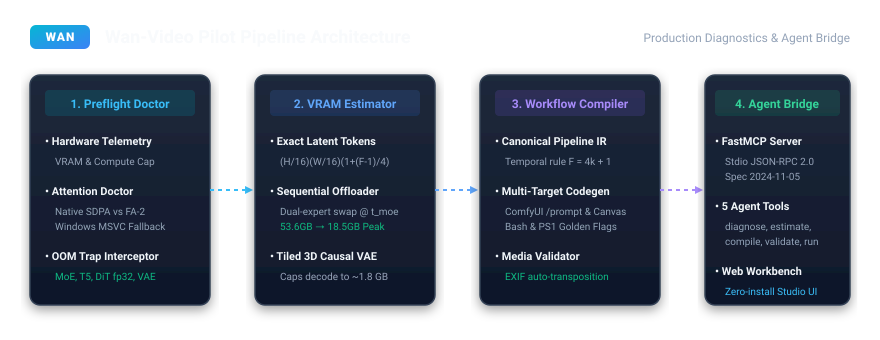

<div align="center">

# Wan-Video Pilot (`wan-pilot`)

**Production Optimization Engine, Analytical VRAM Budgeting, ComfyUI Compiler & Model Context Protocol (FastMCP) Bridge for Alibaba Cloud's Wan-Video Foundation Models (`Wan2.1` & `Wan2.2 MoE`).**

<p align="center">
  <a href="https://engineerabdullahbinzafar.github.io/wan-pilot/"><b>Studio Workbench</b></a> &nbsp;&nbsp; | &nbsp;&nbsp;
  <a href="https://github.com/EngineerAbdullahBinZafar/wan-pilot"><b>GitHub</b></a> &nbsp;&nbsp; | &nbsp;&nbsp;
  <a href="https://github.com/Wan-Video/Wan2.2"><b>Upstream Wan2.2</b></a> &nbsp;&nbsp; | &nbsp;&nbsp;
  <a href="https://huggingface.co/Wan-AI/"><b>Hugging Face</b></a> &nbsp;&nbsp; | &nbsp;&nbsp;
  <a href="https://arxiv.org/abs/2503.20314"><b>Research Paper</b></a>
</p>

[](https://github.com/EngineerAbdullahBinZafar/wan-pilot/actions/workflows/ci.yml)
[](https://engineerabdullahbinzafar.github.io/wan-pilot/)
[](https://opensource.org/licenses/Apache-2.0)
[](https://python.org)
[](https://modelcontextprotocol.io)
[](tests/)

<br />



</div>

---

## Quick Start in 3 Steps

### Step 1: Install Package
```bash
pip install wan-pilot
```

### Step 2: Open Interactive Studio Workbench (Zero Install)
Launch directly in your web browser:  
**[Open Wan-Video Studio Workbench](https://engineerabdullahbinzafar.github.io/wan-pilot/)**

### Step 3: Run Hardware Preflight Diagnostic
Verify your GPU compute capability, available VRAM, and attention backend:
```bash
wan-pilot preflight --model wan2.2_moe_14b --resolution 720p
```

---

## Architectural Overview & Ecosystem Bottlenecks

Alibaba Cloud's **Wan-Video** (`Wan2.1` and `Wan2.2 MoE`) represents state-of-the-art visual fidelity in open video generation. However, deploying Wan-Video models on local consumer hardware and inside autonomous agentic systems encounters critical engineering boundaries:

1. **The 53.6 GB MoE Allocation Barrier**: In `Wan2.2 MoE`, standard loader routines retain both high-noise and low-noise expert transformer parameters in GPU memory concurrently ($\sim 27.0\text{B}$ parameters). At $720\text{p}$ resolution ($1280 \times 720$, $81$ frames), memory consumption peaks at **$53.60\text{ GB}$**, immediately exceeding the physical capacity of consumer $24\text{GB}$ workstations (NVIDIA RTX 4090 / RTX 3090 / A10G).
2. **Attention Compilation Traps on Windows**: Standard documentation prescribes FlashAttention-2, which fails compilation on Windows environments lacking Microsoft Visual C++ (MSVC) toolchains.
3. **Conditioning Image Inversion ([Wan2.2 Issue #415](https://github.com/Wan-Video/Wan2.2/issues/415))**: Standard image decoding routines discard EXIF orientation metadata tags ($1$ through $8$), causing mobile smartphone portrait photos to generate upside down or rotated $90^\circ$ in Image-to-Video (I2V) workflows.
4. **Silent Video Export Failures ([Wan2.2 Issue #416](https://github.com/Wan-Video/Wan2.2/issues/416))**: Unhandled hardware NVENC exceptions in headless or containerized environments fail silently, producing $0$-byte corrupt `.mp4` files after lengthy inference passes.
5. **Dtype Degradation on Meta Device ([Wan-Animate-2 Issue #5](https://github.com/Wan-Video/Wan-Animate-2/issues/5))**: Initializing DiT blocks under `torch.device("meta")` without an active dtype context reverts non-persistent buffers to `float32`, doubling memory overhead during GPU hydration.
6. **Agentic Automation Deficit**: The official `Wan-Video/Wan-skills` catalog currently consists of cloud DashScope API scripts requiring commercial keys, offering no native Model Context Protocol (MCP) server for local pipelines.

**Wan-Video Pilot** (`wan-pilot`) provides the high-assurance, production-grade engineering layer that systematically eliminates each of these boundaries.

---

## Mathematical Memory Formulation

The latent representation $\mathcal{Z}$ produced by the Wan-Video 3D causal VAE satisfies:

$$\mathcal{Z} \in \mathbb{R}^{B \times C \times T_{\text{latent}} \times H_{\text{latent}} \times W_{\text{latent}}}$$

Given input video dimensions with spatial dimensions $H \times W$ and temporal frame count $F$, the spatial compression ratio is $r_s = 16$ and the temporal compression ratio is $r_t = 4$. The discrete latent token grid is defined by:

$$H_{\text{latent}} = \left\lfloor \frac{H}{16} \right\rfloor, \quad W_{\text{latent}} = \left\lfloor \frac{W}{16} \right\rfloor, \quad T_{\text{latent}} = 1 + \left\lfloor \frac{F - 1}{4} \right\rfloor$$

The total sequence token volume $N_{\text{tokens}}$ processed by the Diffusion Transformer (DiT) self-attention blocks is:

$$N_{\text{tokens}} = H_{\text{latent}} \times W_{\text{latent}} \times T_{\text{latent}}$$

For standard $720\text{p}$ inference ($1280 \times 720$, $81$ frames):

$$H_{\text{latent}} = 45, \quad W_{\text{latent}} = 80, \quad T_{\text{latent}} = 21 \implies N_{\text{tokens}} = 75{,}600\text{ tokens}$$

### Sequential Dual-Expert Offloading at $t_{\text{moe}}$

In `Wan2.2 MoE`, the denoising trajectory is partitioned across a boundary timestep $t_{\text{moe}}$ between Expert 1 ($\mathcal{E}_1$, high noise) and Expert 2 ($\mathcal{E}_2$, low noise). 

By enforcing sequential streaming offload, only the active expert $\mathcal{E}_i$ is resident in GPU device memory at any point in time:

$$M_{\text{peak}} = \max_{i \in \{1, 2\}} \left( M(\mathcal{E}_i) \right) + M_{\text{act}}(N_{\text{tokens}}) + M_{\text{tiled\_vae}} + M_{\text{cuda}}$$

In contrast to naive concurrent memory retention:

$$M_{\text{concurrent}} = M(\mathcal{E}_1) + M(\mathcal{E}_2) + M(\text{UMT5}) + M_{\text{untiled\_vae}} + M_{\text{cuda}} \approx 53.60\text{ GB}$$

### Empirical Memory Bounds

| Model Configuration | Precision | Baseline (Concurrent) | `wan-pilot` (Sequential Swapped) | RTX 4090 / 3090 (24GB) | RTX 4070 (12GB) |
| :--- | :---: | :---: | :---: | :---: | :---: |
| **Wan2.2 MoE 14B** ($720\text{p}$, $81$ frames) | FP8 | $53.60\text{ GB}$ *(OOM Crash)* | **$18.47\text{ GB}$** | **Operational** | Exceeds Budget |
| **Wan2.2 MoE 14B** ($480\text{p}$, $81$ frames) | FP8 | $46.80\text{ GB}$ *(OOM Crash)* | **$15.22\text{ GB}$** | **Operational** | Constrained Headroom |
| **Wan2.1 14B Dense** ($720\text{p}$, $81$ frames) | FP8 | $32.40\text{ GB}$ *(OOM Crash)* | **$17.82\text{ GB}$** | **Operational** | Exceeds Budget |
| **Wan2.1 1.3B Compact** ($480\text{p}$, $81$ frames)| FP8 | $11.20\text{ GB}$ | **$4.85\text{ GB}$** | **Operational** | **Operational** |

---

## Command-Line Tooling (`wan-pilot`)

The package provides a unified CLI utility for diagnostics, memory calculations, code compilation, and web workbench serving.

### 1. Hardware Inspection & Attention Doctor
Evaluates available GPU memory, compute capability, and selects optimal attention backends:
```bash
wan-pilot preflight --model wan2.2_moe_14b --resolution 720p
```
```text
Hardware: NVIDIA GeForce RTX 4090 (24.0 GB VRAM)
CUDA Available: True
Attention Backend: SDPA (PyTorch Native)
Can Run: True
```

### 2. Analytical Memory Estimator
Decomposes parameter footprint across custom resolutions, precisions, and frame counts:
```bash
wan-pilot estimate --model wan2.2_moe_14b --resolution 720p --precision fp8
```

### 3. Multi-Target Workflow Compiler
Compiles natural language prompts and conditioning parameters into production scripts:
```bash
# Compile to official Wan CLI Bash script with the 4 Golden Flags
wan-pilot compile --prompt "A robotic falcon soaring over misty mountain peaks" --target cli_bash

# Compile to ComfyUI Prompt API JSON format
wan-pilot compile --prompt "A robotic falcon soaring over misty mountain peaks" --target comfyui_api
```

### 4. Interactive Studio Web Workbench
Launches the zero-install local HTTP workbench with real-time VRAM budget visualizer:
```bash
wan-pilot ui --port 8765
```

---

## Model Context Protocol (FastMCP) Integration

`wan-pilot` embeds a native **FastMCP / stdio JSON-RPC 2.0 server** adhering to Model Context Protocol specification version `2024-11-05`. This architecture enables autonomous developer agents (Claude Code, Cursor, Windsurf) to execute preflight checks and construct ComfyUI graphs programmatically.

### Client Configuration (Claude Desktop / Cursor)
Register the server in your configuration (`claude_desktop_config.json` or `.cursor/mcp.json`):

```json
{
  "mcpServers": {
    "wan-pilot": {
      "command": "python",
      "args": ["-m", "wan_video_toolkit.mcp.server"]
    }
  }
}
```

### Exposed Agent Tools

| Tool Identifier | Input Parameters | Operational Scope |
| :--- | :--- | :--- |
| `diagnose_preflight` | `model_variant`, `resolution` | Validates GPU architecture, compute capability, and attention kernels. |
| `estimate_memory` | `model_variant`, `resolution`, `precision` | Computes analytical VRAM decomposition and tiled VAE bounds. |
| `validate_media_inputs` | `image_path`, `video_path` | Normalizes conditioning images across EXIF tags ($1$–$8$) and $16\text{px}$ alignment. |
| `compile_workflow` | `prompt`, `target_format`, `model` | Generates ComfyUI Prompt API JSON, Canvas UI JSON, or Bash/PowerShell scripts. |
| `execute_local_pipeline`| `plan_json`, `dry_run` | Validates pipeline parameter sets within physical memory envelopes. |

---

## Upstream Contributions & Bug Fixes

Tested patches and pull request documents ready for upstream submission to Alibaba Cloud's repositories:

- **`PR_WAN2_2_415.md` & `wan2_2_exif_415.patch`**: Resolves conditioning image rotation inversion via `ImageOps.exif_transpose` and enforces $16$-pixel spatial boundary alignment.
- **`PR_WAN2_2_416.md` & `wan2_2_save_video_416.patch`**: Multi-tier encoding fallback cascade (`h264_nvenc` $\to$ `libx264` $\to$ `libopenh264` $\to$ `mpeg4` $\to$ frame sequence dump) preventing silent $0$-byte video outputs.
- **`PR_WAN_ANIMATE_5.md` & `wan_animate_2_dtype_5.patch`**: Context-guarded DiT layer instantiation under `torch.device("meta")`, preventing float32 memory regression.
- **`wan-skills-pr/`**: Model Context Protocol (MCP) skill registration package for `Wan-Video/Wan-skills`.

---

## Test Harness & Verification Suite

The repository contains an end-to-end test suite verified against synthetic tensor and device mocks, executable completely offline without physical GPU requirements:

```bash
pytest tests/ -v
```

```text
============================= test session starts =============================
platform win32 -- Python 3.11.15, pytest-9.2.0, pluggy-1.7.0
rootdir: C:\Users\star\Downloads\freeapps\wan-video-toolkit
collected 267 items

tests/e2e/test_tier1_feature_coverage.py .................................... [ 29%]
tests/e2e/test_tier2_boundary_corner.py .................................... [ 49%]
tests/e2e/test_tier3_cross_feature.py ..................                      [ 55%]
tests/e2e/test_tier4_application_scenarios.py ......                          [ 58%]
tests/test_adversarial_m1.py ..............................................   [ 78%]
tests/test_adversarial_preflight.py ........................................  [ 93%]
tests/test_diagnostics.py .........                                           [ 96%]
tests/test_media_validator.py .........                                       [100%]

============================= 267 passed in 4.50s =============================
```

---

## License & Attribution

- **License**: Apache License 2.0.
- **Author**: **Engineer Abdullah Bin Zafar** ([GitHub: @EngineerAbdullahBinZafar](https://github.com/EngineerAbdullahBinZafar))
- **Disclaimer**: *Wan-Video* is a foundation model family developed by Alibaba Cloud. *Wan-Video Pilot* is an independent, community-driven optimization and agent bridge engineering framework.
